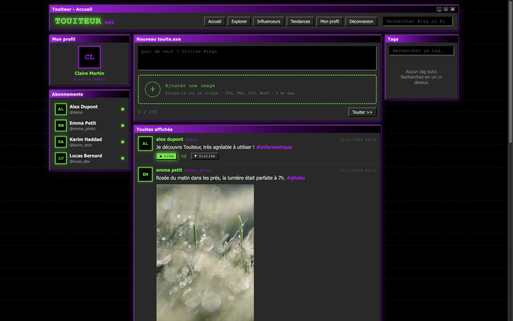
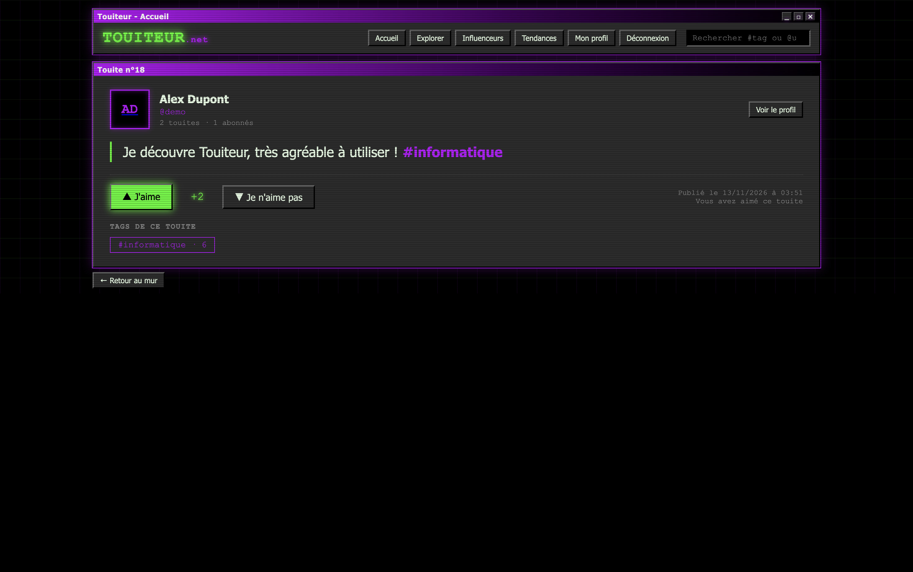
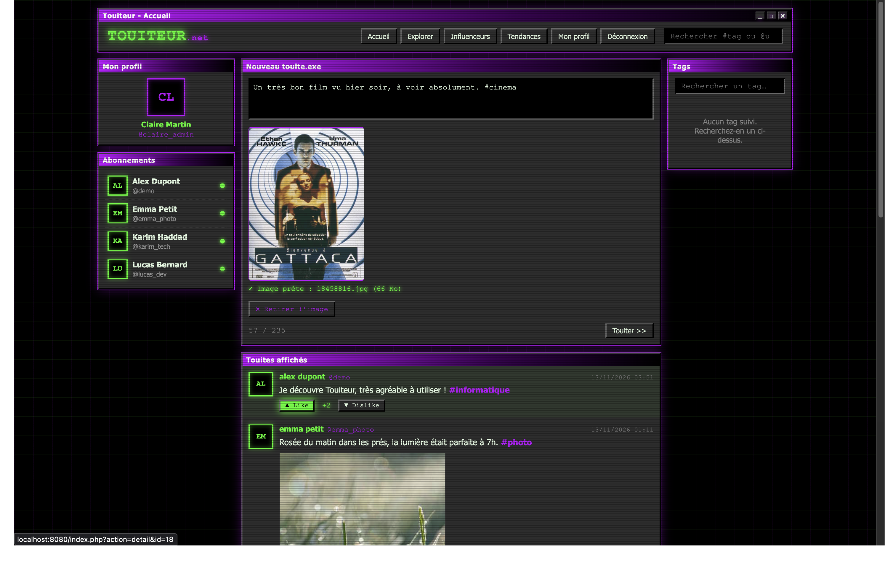
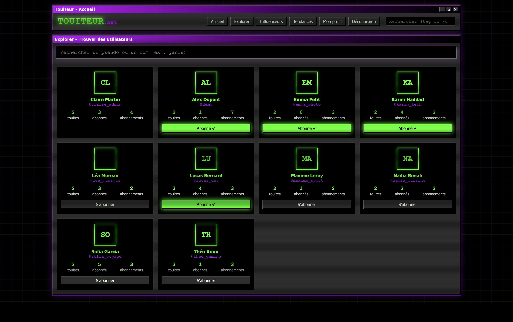
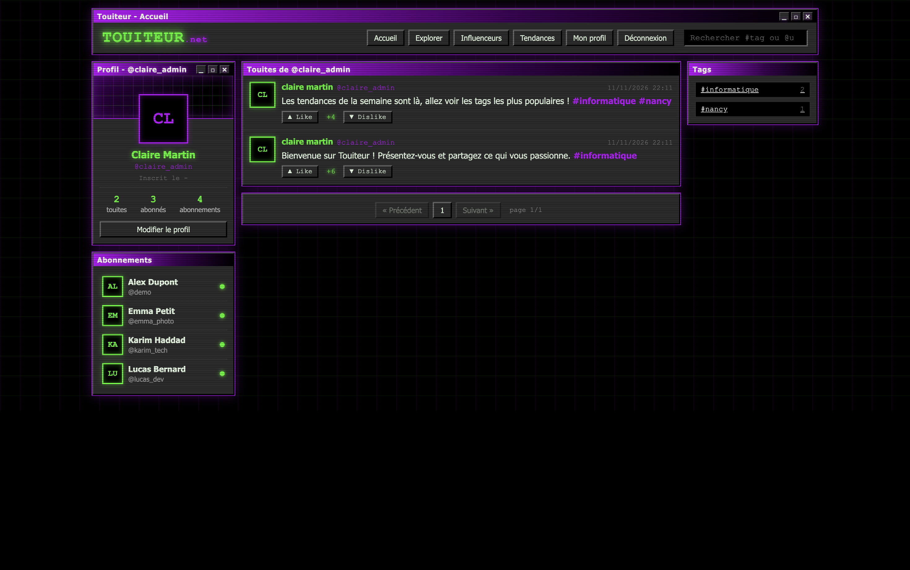
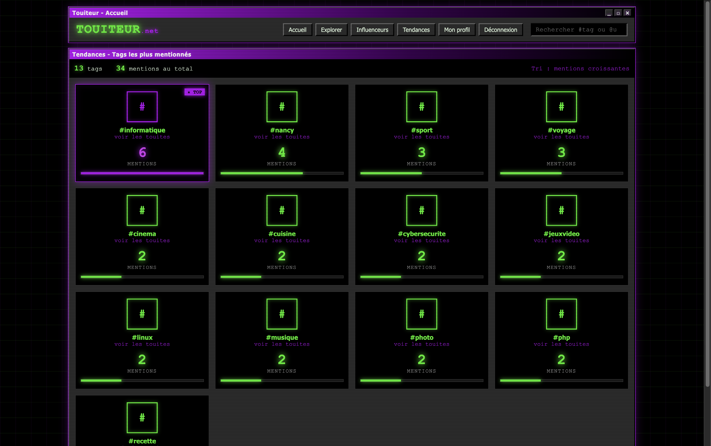
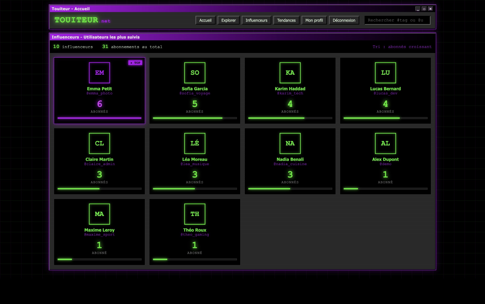

# Touiteur

Touiteur est une application web de micro-blogging inspirée de Twitter, réalisée dans le cadre de la SAE « Développer une application web sécurisée » du BUT Informatique (3e semestre).

Les utilisateurs peuvent publier des touites courts (235 caractères maximum), les classer avec des #tags, suivre d'autres utilisateurs, s'abonner à des tags et évaluer les touites.

## Captures d'écran

### Accueil (fil de touites)


### Détail d'un touite


### Publication d'un touite (avec image et tags)


### Explorer et recherche


### Profil utilisateur


### Tendances (administrateur)


### Influenceurs (administrateur)


## Fonctionnalités

- **Inscription, connexion et déconnexion** des utilisateurs
- **Publication de touites** de 235 caractères maximum, avec image optionnelle
- **Gestion automatique des tags** : les #tags présents dans un touite sont extraits et enregistrés
- **Liste des touites** en ordre chronologique inverse, avec **pagination**
- **Détail d'un touite** : texte complet, note, image et auteur
- **Évaluation** d'un touite (like ou dislike) : une seule évaluation par utilisateur et par touite, la note est mise à jour automatiquement
- **Recherche** de #tags et de @utilisateurs, et page **Explorer**
- **Profil utilisateur** : touites de l'utilisateur, abonnés et abonnements, possibilité de suivre ou ne plus suivre
- **Abonnement à des tags** pour suivre les touites qui les contiennent
- **Influenceurs** : liste des utilisateurs les plus suivis (administrateur)
- **Tendances** : classement des tags les plus mentionnés (administrateur)

## Technologies

- **Back-end** : PHP (programmation orientée objet, autoloader maison, espaces de noms `touiteur\...`)
- **Base de données** : MySQL / MariaDB, accès via PDO
- **Front-end** : HTML, CSS et JavaScript sans framework

## Structure du projet

```
├── index.php              # Point d'entrée et table de routage
├── db.config.ini          # Paramètres de connexion (non versionné)
├── sql/script.sql         # Création des tables, contraintes et triggers
├── public/                # CSS et JavaScript
├── src/
│   ├── loader/            # Autoloader
│   └── classes/
│       ├── action/        # Contrôleurs (une classe par action)
│       ├── dispatch/      # Routage des actions
│       ├── exceptions/    # Exceptions métier
│       ├── render/        # Rendu des templates (View, Template)
│       ├── repository/    # Accès aux données (TouiteurRepository)
│       └── touites/       # Modèles (Touite, Evaluation)
├── templates/             # Vues : layout, pages et éléments réutilisables
└── uploads/images/        # Images envoyées par les utilisateurs
```

## Installation

### Prérequis

- Docker et Docker Compose, ou PHP 8.1+ avec un serveur MySQL / MariaDB
- Git

### 1. Cloner le dépôt

```bash
git clone https://github.com/<votre-utilisateur>/SAE-TOUITEUR.git
cd SAE-TOUITEUR
```

### 2. Créer le fichier de configuration

Le fichier `db.config.ini` n'est pas versionné. Créez-le à la racine du projet :

```ini
driver=mysql
host=<hôte de la base>
dbname=touiteur
username=<utilisateur>
password=<mot de passe>
```

### 3. Créer la base de données

```bash
mysql -u <utilisateur> -p < sql/script.sql
```

Le script crée la base `touiteur`, toutes les tables, les contraintes et les triggers qui maintiennent la note des touites.

### 4. Lancer l'application

```bash
php -S localhost:8000
```

Puis ouvrez [http://localhost:8000](http://localhost:8000).

### 5. Créer un administrateur (facultatif)

Les pages Tendances et Influenceurs sont réservées aux administrateurs. Après inscription d'un compte, passez son rôle à `admin` :

```sql
UPDATE UTILISATEUR SET role = 'admin' WHERE id_utilisateur = '<pseudo>';
```

## Auteurs

- JOSHUA RUELRAMOS
- YANIS PETIT
- MARWANE HANINI
- MATHEO BRANGER
